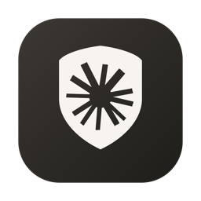

<div align="center">

# ClaudeSwitcher

**Claude 环境检查器 — a fail-closed local environment manager for multiple Claude accounts**

[中文](README.md) · [GitHub](https://github.com/huanfine/claude-switcher) · [Issues](https://github.com/huanfine/claude-switcher/issues)

> Based on [YOURSJEYO/claude-switcher](https://github.com/YOURSJEYO/claude-switcher) (MIT) — see [Origin and License](#origin-and-license).



</div>

---

## What it is

ClaudeSwitcher keeps several Claude accounts on one Mac without letting their
local state mix. Each account has its own device fingerprint, sign-in
credentials, and application data; switching swaps those directories atomically
instead of signing out and back in.

Before Claude starts, the app runs a **16-point audit** of the machine's network
and regional environment. If a blocking check fails, the app is not launched. A
resident bodyguard stops the protected application when the tunnel drops, and a
runtime watchdog compares the live egress against the baseline captured at
launch time.

The desktop window is titled **Claude 环境检查器**. `ClaudeSwitcher` remains the
repository, command-line script, and build artifact name.

## Features

- **16-point preflight audit** — proxy core, TUN interface, exit country, IP
  stability, time zone, locale, IPv6, DNS tunnel, WebRTC candidates, bodyguard
  status, pinned routing, client language, ASN type, IP purity score, Claude
  reachability, and better-node availability. Results are `ok` / `fail` /
  `config` / `warn` / `skip`; both `fail` and `config` block launch, and `skip`
  never counts as a pass.
- **Snapshot switching (A–D)** — archives and restores whole account
  directories; APFS copy-on-write cloning avoids duplicating unchanged data.
  A slot also carries the Claude Code CLI state (`~/.claude/` and
  `~/.claude.json`), so the terminal and the desktop app never share a session.
  Switching is refused while `claude` is running in a terminal.
- **Per-slot exit node binding** — declare one fixed exit for each slot; switching
  to that slot applies the bound node before switching accounts. Unbound slots
  use the best node from the current scan. Binding takes priority over the scan.
- **Fail-closed bodyguard** — checks the proxy kernel and virtual interface
  every ten seconds and terminates protected processes when the tunnel is lost.
- **Runtime egress watchdog** — samples the exit every 10s, runs a full audit
  every 60s, and stops Claude if the egress changes or the audit fails twice.
- **Drift watchdog** — records a baseline for time zone and proxy settings and
  rolls back silent changes made by other software.
- **Multiple proxy clients** — Clash Verge, FlClash, Shadowrocket, sing-box,
  ClashX, Surge, and an automatic mode. Clash Verge and FlClash repairs install
  and verify routing rules with rollback; other clients keep their own rules.
- **Region adaptation** — captures the exit country, time zone, and locale at
  install time and re-locks all three after moving to a different node.
- **Pinned routing** — places Claude domains and supporting services above
  third-party rule sets, with a CIDR fallback that does not depend on a client
  database.
- **WebRTC leak probe** — a standard-library STUN client that compares global
  and local vantage points to distinguish a proxied path from a direct one.
- **IP purity score** — an explainable 0–100 score from four independent data
  sources plus local PTR, with degraded verdicts when sources are unreachable.
  A low score is a soft signal: it never decides whether Claude can start, so
  the home screen shows passed-check counts instead of an overall score.
- **Node scan and gated apply** — read-only ranking of the current Selector's
  candidate nodes; applying the best node requires a fresh real-time gate,
  re-checks the exit country, and rolls back on any failed step.
- **Automatic updates** — a user-level LaunchAgent checks every 12 hours,
  verifies artifact hashes against `SHA256SUMS`, and rolls back if the
  post-update self-check fails.
- **Diagnostics and inspection** — standalone proxy transport diagnosis, device
  fingerprint report, Claude Code CLI inspection, one-shot isolated browser,
  encrypted snapshot export/import, and redacted diagnostic bundles.
- **Native menu bar UI** — a single-file SwiftUI app with no Xcode project and
  no third-party dependencies; the icon is generated from `assets/icon-gen.swift`.
- **Web check page** — a static browser-side check for exit IP, time zone,
  language, WebRTC, IPv6, DNS reachability, and common fingerprint signals.
- **Windows and Linux ports (beta)** — PowerShell and bash implementations with
  the same audit and switching model. Windows also includes A–D accounts,
  proxy-client switching, read-only inspection tools, isolated browsing,
  standalone proxy diagnostics, and encrypted `.csnap` snapshots (not
  compatible with macOS DMG). New Windows UI and runtime flows still require
  hardware verification; static checks are not a substitute.

## Install

### Another machine: one package, one double-click (recommended)

Download `*-macos-arm64-full.zip` from the
[latest release](https://github.com/huanfine/claude-switcher/releases/latest),
unzip it, and double-click `INSTALL.command`. Confirm the proxy group / region and
enter your password once; the app appears on the Desktop.

The bundle already contains the compiled app, core script, daemons, and installer:
**no Xcode, no choosing between packages, no separate upgrade command.** The target
needs macOS 13+, Apple Silicon, python3, a running proxy client, and the Claude
desktop app. The app is ad-hoc signed and not notarized, so the first launch may need
right-click → Open (the launcher clears download quarantine inside the package).
**Use only `INSTALL.command`.** Current full bundles are ASCII-only: after unzipping,
that is the one and only `.command` in the folder. macOS Archive Utility renders
Chinese filenames from older bundles as garbled text even when the UTF-8 flag is set;
that garbled `.command` cannot be opened and is not an entry point — do not
double-click it and do not paste its name into a terminal. If you already unzipped a
bundle that contains `INSTALL.command`, just run `./INSTALL.command` there; no need
to download again. See `README-INSTALL.txt` inside the package.

**Do not use the old upstream `YOURSJEYO/claude-switcher` release**: its core script
predates `node-scan` / `slot-node` and fails with `exit code 2` on node scan.

```bash
shasum -a 256 -c SHA256SUMS-release.txt
~/.local/bin/claude-switch.sh help | grep -E 'node-scan|slot-node'
```

Other packages are only for special cases: `*-installer-kit.zip` (Intel Mac or
build from source), `*-app-only.dmg` (UI only), `scripts/upgrade-core.sh` (upgrade
a stale core in place), `*-windows.zip` / `*-linux.tar.gz` (Beta). Pushing a `v*`
tag triggers the release workflow to rebuild and publish every package.

> The kit still contains Chinese-named files such as `installer/安装.command`, which
> may look garbled after unzipping. There too, **use only the top-level
> `INSTALL.command`** and ignore anything garbled under `installer/`.

### Upgrading an existing install

Which half changed matters. The "Repair appears to do nothing" fix in `1.8.7-dev`
changed **both** the menu-bar app binary **and** `~/.local/bin/claude-switch.sh`,
so running `scripts/upgrade-core.sh` alone (or installing `*-app-only.*` alone)
upgrades only half of it. Releases that change only the core script (such as
`1.8.8-dev`) need just the core upgrade.

When in doubt, re-run the full bundle — it is the least error-prone path:

1. Download `*-macos-arm64-full.zip` from the
   [latest release](https://github.com/huanfine/claude-switcher/releases/latest).
2. Unzip it and double-click the top-level `INSTALL.command`; enter your login
   password once. The installer overwrites the desktop app, the core script and the
   daemons, and **does not delete account slots, snapshots, or proxy settings**.
3. Fully quit the old menu-bar app, reopen it, and verify both halves:

```bash
plutil -extract CFBundleShortVersionString raw "$HOME/Desktop/Claude 环境检查器.app/Contents/Info.plist"
shasum -a 256 "$HOME/.local/bin/claude-switch.sh"
curl -fsSL https://raw.githubusercontent.com/huanfine/claude-switcher/main/SHA256SUMS | grep 'core/claude-switch.sh'
```

The app version should match the release page, and the core hash should match the
`SHA256SUMS` line. **Do not copy a hash hardcoded in docs** — the core script
changes with every fix.

Then click Repair again. The new UI separates "the script never started", "some
items were fixed but the final re-check failed", and "this item cannot be fixed by
script" instead of showing one generic "script failed". If it still does not work,
run `bash scripts/diagnose-fix.sh` from the unzipped folder and send back
`claude-fix-diagnosis.txt` from the Desktop; it contains every `FIX:` line and the
real exit code.

### From source

Requirements: macOS 13 or later, a proxy client with TUN support (Clash Verge,
FlClash, Shadowrocket, sing-box, ClashX, or Surge), the Claude desktop app, and
Python 3. The exit country must not be `CN` — the installer derives the target
country, time zone, and locale from the current egress.

```bash
git clone https://github.com/huanfine/claude-switcher.git
cd claude-switcher
# Then double-click installer/安装.command
```

The installer detects the proxy client, proxy group, and regional target, then
builds the desktop app locally and installs the core script, bodyguard, and
time-zone watchdog. The command-line entry point is
`~/.local/bin/claude-switch.sh`. To build and package manually:

```bash
bash scripts/package-macos.sh 1.0.0
```

Artifacts are written to `build/`. macOS builds are ad-hoc signed and not
notarized. If Gatekeeper blocks the first launch, open the app from the context
menu or allow it under **System Settings → Privacy & Security**.

For Windows, see [`windows/README.md`](windows/README.md); for Linux, see
[`linux/README.md`](linux/README.md).

## New UI + old core script

The `*-app-only.zip` / `*.dmg` artifacts replace the UI only; they do **not**
update `~/.local/bin/claude-switch.sh`. Scanning for nodes then fails with
`脚本执行失败（退出码 2）` followed by an old `用法: claude-switch.sh ...` usage
line. If that line has no `node-scan` / `slot-node`, the core script is stale.

Older cores (around v1.7.1) hard-coded the original upstream repository in
`update`, so running `update` there will never fetch this fork. The app shows a
copyable command instead; run it in a terminal:

```bash
bash <(curl -fsSL https://raw.githubusercontent.com/huanfine/claude-switcher/main/scripts/upgrade-core.sh)
```

It downloads the core script and `SHA256SUMS` from `main`, verifies the hash,
backs up the old script, migrates `env.json`, and self-checks via `help` /
`status`; any failure rolls back automatically. Alternatively, reinstall from
the latest `*-installer-kit.zip` (the same script ships inside the kit). Account
switching keeps working on a stale core — only node scanning is skipped.

## Node without UDP support

HTTP and other nodes without UDP report `udp:false` in the running kernel. The
`proxy` WebRTC policy requires a UDP-capable node (otherwise STUN traffic can
bypass the tunnel), so **WebRTC** and **Pinned routing** both fail with the same
message — the latter is not actually testing your rules. Click **One-click
repair**: it persists the `reject` policy (UDP is rejected outright, so there is
still no leak), then writes and verifies the pinned rules under that policy and
restarts the proxy client once. To switch manually:

```bash
~/.local/bin/claude-switch.sh set-webrtc-policy reject   # or proxy
```

Keep `proxy` only if you switch to a UDP-capable node. When `IP purity` reports
a "type estimate / reputation not measured" score, none of the risk sources
answered: that number is a type-based baseline, not a measured reputation, and
it is retried automatically after 5 minutes.

## Exit IP score looks wrong

Three known causes, all fixed: a `dig` timeout diagnostic line was once parsed
as a PTR record and printed as the ISP name; a leftover `.purity-cache.lock`
directory (from a killed process) silently blocked every cache write for hours,
so each check re-queried four sources and the score drifted with the network;
and operators outside the residential whitelist were always labelled
"datacenter" even when all three sources said `is_datacenter:false`. Stale
locks older than 60 seconds are now reclaimed. The type is now decided by
evidence, not by name: a whitelist hit is residential, an explicit
datacenter/cloud/backbone keyword in the operator name is datacenter, and
when both risk sources deny hosting with a low risk score the exit is scored
as residential — the same call ip.net.coffee makes. Only when the evidence is
incomplete does it fall back to the neutral 70-point `warn` baseline. The
geography dimension is flagged but no longer deducted from the score.

If the app **still** says "datacenter / type unknown" after upgrading, check the
core script, not the app: every verdict in the UI comes from
`~/.local/bin/claude-switch.sh`, and the app implements none of the type logic
itself. An `*-app-only.*` package replaces the app only. Compare
`shasum -a 256 ~/.local/bin/claude-switch.sh` against `SHA256SUMS` and, if they
differ, run
`bash <(curl -fsSL https://raw.githubusercontent.com/huanfine/claude-switcher/main/scripts/upgrade-core.sh)`.
Measured on one machine and one exit (`66.17.65.38`, AS3257): the old core
reported "datacenter, 70/100, type unknown"; the current core reports "operator
not classified, 100/100, residential broadband". Only the script version
differed.

The score is IP reputation; whether the exit is usable for Claude is decided
separately by hard gates, so the two can diverge. Under the `reject` policy UDP
is rejected at the rule level, so node UDP support is no longer a hard gate.

## Repair reports ✗ but a fresh check is green

`fix` restarts the proxy client after writing the global script. Older builds
probed the exit immediately — while TUN was up but the default route had not
converged — got an empty trace and ended with `WebRTC ✗` / `Exit IP ✗` and
`exit=1`, even though the rules were written and verified. The restart path now
waits for egress before re-testing; when nothing changed and no restart happens,
no extra request is made.

## Clicking "Repair" appears to do nothing

Starting with `1.8.7-dev`, the UI separates three cases instead of reporting one
generic "script failed":

- **The script never started** (preflight exits immediately, `duration_ms=0` in
  the log): the raw error plus an actionable hint are shown. The usual cause is
  that a Finder-launched menu bar app inherits a minimal PATH and cannot find
  `python3`, while the installer checked it from a full Terminal PATH. The core
  now resolves the interpreter by absolute path instead of relying on PATH. If
  Python really is missing, follow the hint and run `xcode-select --install`.
- **The flow finished but the final re-test failed**: previously any non-zero
  exit wiped every `FIX:` receipt and showed only "script failed (exit 1)", which
  looked like nothing had been repaired. Receipts are now kept, remaining items
  needing manual action are named, and a fresh check runs afterwards.
- **Items a script cannot fix**: exit IP, ASN, IP purity, ecosystem reachability
  and "better node" require switching lines/nodes; the button will not turn them
  green.

For troubleshooting, use "Export diagnostics" in the app: `1.8.7-dev` adds a
`last-fix.log` with the step-by-step `FIX:` output of the last repair (IPs, local
paths and credentials redacted). For the full picture, run one line in Terminal
**on the affected Mac** and send back `claude-fix-diagnosis.txt` from the Desktop:

```bash
bash <(curl -fsSL https://raw.githubusercontent.com/huanfine/claude-switcher/main/scripts/diagnose-fix.sh)
```

It runs `fix` once for real (an admin password prompt may appear) and records
every step, the exit code and a follow-up check.

## "Rules already up to date" and "UDP 3478 rule not pinned" together

This contradiction in `last-fix.log` is easy to miss:

```text
FIX:置顶规则 ✓ 规则已是最新,未重启客户端
FIX:WebRTC ✗ UDP 3478 规则没置顶 · 点「一键修复」
```

`write_merge_rules` only compares `Script.js` / `Merge.yaml` on disk and reports
"no change"; `clash_rules verify` reads `/rules` from the **running kernel**. After
a cold client start, a TUN rebuild, or the global extension script being disabled,
the files are correct but the kernel never loaded them. The old logic saw "no
change", skipped the restart, and the final re-test failed every single time —
while telling you to "click Repair", i.e. the button you had just clicked.

The "no change" branch now asks the kernel first: only when both agree is the
restart skipped. A `rules not pinned` failure (which a restart can actually fix)
restarts the client and waits for `verify` to pass. Causes a restart cannot fix —
a node without UDP, non-rule mode, a wrong proxy group — are reported directly
instead of making you wait through a TUN rebuild. The final line no longer points
back at the same button.

> `1.8.8-dev` changed only the core script; the app binary is unchanged.
> **Only machines already on 1.8.7-dev** can skip the full bundle and upgrade the
> core in place. If the UI is older, re-run the full bundle as described above:
>
> ```bash
> bash <(curl -fsSL https://raw.githubusercontent.com/huanfine/claude-switcher/main/scripts/upgrade-core.sh)
> ```
>
> Verify afterwards with `shasum -a 256 ~/.local/bin/claude-switch.sh` against the
> repository `SHA256SUMS`.

## Usage

1. Open the desktop app and wait for the 16 checks.
2. If everything is green, choose an account and launch Claude. If a blocking
   check is red, use the one-click repair action.
3. Sign in once for each additional account; later switches keep sessions
   independent — for both the desktop app and the `claude` CLI. Exit the CLI
   before switching (it writes to the directory being swapped).
4. To pin an exit to a slot, scan once from the "更优节点 / Better node" row,
   then use the link icon in the top-right corner of a slot card and pick a
   candidate from the report (`slot-node set <A-D> <node>` on the command line).
5. After changing to a node in another country, run
   `~/.local/bin/claude-switch.sh set-region`.

The full command set, menu bar behavior, and troubleshooting notes are in the
[Chinese README](README.md) and [AGENTS.md](AGENTS.md).

## Disclaimer

This project is intended for managing the local environment and sign-in state of
multiple Claude accounts in supported regions, for people who are traveling,
living abroad, or otherwise legitimately located in a supported region. Please
follow Anthropic's Terms of Service. Do not use it for account resale, account
sharing, registering accounts on behalf of others, or circumventing regional
restrictions.

Local environment checks only inspect and configure this machine. They do not
change server-side records and do not guarantee that an account will not be
restricted. The software is provided as-is under the MIT license; you are
responsible for how you use it.

## Links

- [中文说明](README.md)
- [GitHub 仓库](https://github.com/huanfine/claude-switcher)
- [Issues](https://github.com/huanfine/claude-switcher/issues)
- [Security policy](SECURITY.md)
- [Agent handoff guide](AGENTS.md)
- [Web environment check](https://huanfine.github.io/claude-switcher/) — published
  from `docs/`; enable GitHub Pages (`Deploy from a branch` / `main` / `/docs`)
  before the link resolves.
- [Windows beta](windows/README.md) · [Linux beta](linux/README.md)

## Origin and License

This project is a fork of [YOURSJEYO/claude-switcher](https://github.com/YOURSJEYO/claude-switcher) (MIT License). The original copyright and permission notice are kept in [LICENSE](LICENSE). The UI redesign, additional checks, node scanning and documentation maintenance in this repository are maintained by huanfine.

MIT © Claude Switcher Contributors
