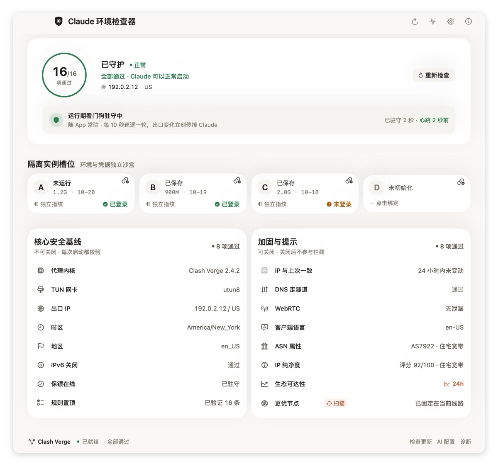

<div align="center">

# Claude 环境检查器

**Fail-Closed 账号环境管理器 —— 把真实 IP 泄漏拦截在启动之前**

[English](README.en.md) · [GitHub](https://github.com/huanfine/claude-switcher)

[](LICENSE)
[]()
[](windows/)
[](linux/)
[]()


</div>

---

## 这是什么

启动 Claude 之前跑完 **16 项环境审计**，硬性项不过就不拉起应用；放行之后由运行期看门狗守着出口，一变就停 Claude。账号切换用整目录快照（A–D 四个独立档案），而不是反复登录登出。

桌面窗口标题为「Claude 环境检查器」，命令行入口 `~/.local/bin/claude-switch.sh`。界面是单文件 SwiftUI，无 Xcode 工程、无第三方依赖；图标由 `assets/icon-gen.swift` 生成。

## 用途声明

本项目用于在合规地区管理多个 Claude 账号的本地环境与登录态，面向因出差、旅居等原因身处支持地区的用户。请遵守 Anthropic 服务条款；禁止用于账号转售、共享、代注册或规避地区限制。本地环境检查只影响本机配置，不改变服务端记录，也不构成账号不被限制的保证。

## 界面



浅色 / 深色两态另见 [docs/images/](docs/images/)。

## 16 项检查

| # | 检查项 | 防什么 |
|---|---|---|
| 01 | 代理内核 | 代理没在跑就启动 |
| 02 | TUN 网卡 | 系统代理开着但流量没被接管 |
| 03 | 出口 IP | 出口国家 / 地区异常 |
| 04 | IP 一致性 | 出口 IP 漂移（按出口类型分级 + 48h 历史） |
| 05 | 时区 | 系统时区与 IP 归属地冲突、看门狗守着旧目标 |
| 06 | 地区 Locale | 系统区域设置不符 |
| 07 | IPv6 | 双栈旁路直连 |
| 08 | DNS 隧道 | Fake-IP 校验 + 上游解析器地域 |
| 09 | WebRTC | 纯标准库 STUN 多节点交叉探测 |
| 10 | 保镖守护进程 | Kill-Switch 是否在线 |
| 11 | 置顶路由规则 | Claude 生态域名是否被强制走代理 |
| 12 | 客户端语言 | 语言与目标地区不符 |
| 13 | ASN 属性 | 网络类型不符（ISP 分类不等于住宅认证） |
| 14 | IP 纯净度 | 四源交叉 + PTR 的可解释 0–100 评分 |
| 15 | 生态可达性 | claude.ai / api.anthropic.com 连通性 |
| 16 | 更优节点 | 本地候选节点里是否存在更干净的出口 |

结论只有五种：`ok` 通过 / `fail` 实测不达标 / `config` 环境层没配好无从判定 / `warn` 提示 / `skip` 用户主动关闭。**`fail` 与 `config` 都拦启动，`skip` 永远不算通过**。

界面上这是一份清单、不分组，默认全部拦启动。设置页「降级防护（不推荐）」里可关闭 8 项（04/08/09/12/13/14/15/16），另外 8 项不可关闭；关掉后主界面常驻橙色「防护已降级」，`check` 输出也带 `|防护降级:…`。

> Kill-Switch 是**进程级急停**而非防火墙级 fail-closed，隧道断开到进程被杀存在已知时间窗口。完整安全边界见 [SECURITY.md](SECURITY.md)。

## 重点能力

- **四维加权评分**：身份 / 隔离 / 一致 / 守护四个维度，用来诊断和排序。首页**不显示这个分**——圆环里是「通过项数 / 总项数」，颜色只回答「能不能启动」。分数低不等于起不来：IP 纯净度偏低会让分掉下来，但它只是软信号，照样能启动。
- **IP 纯净度**：四源交叉（ipquery / ip-api / ipinfo / stopforumspam）+ 本地 PTR，类型基线减分；机房只给警告，代理特征与 Tor 才拦启动。
- **节点扫描与应用**：只读扫描当前控路 Selector 的候选节点并排名；「应用最优节点」只在门禁允许时出现，按下时实时复核门禁、切后复查出口国家，任一步不达标自动回滚。细节见 [AGENTS.md](AGENTS.md)。
- **一槽一套环境**：切 A–D 时连同 Claude Code 的 `~/.claude/` 与 `~/.claude.json` 一起换，桌面版和终端不再共用同一份登录态。槽位卡上的 `CLI` 角标表示这个槽位也存了终端状态。
- **槽位绑定出口**：可以给每个槽位声明「就走这条线」，切过去时先换线路再切账号；没绑定的槽位沿用「本次扫描最优节点」。绑定优先于本次扫描结果。
- **运行期守护**：放行后每 10s 比对出口、每 60s 跑整轮审计；异常连续两次才停 Claude，拦截写 `incidents.log` 并走窗口横幅 / 菜单栏 / 系统通知三条提醒。
- **菜单栏常驻**：关窗口只隐藏、Dock 不显示图标；菜单显示当前槽位与最近检查结果。
- **检查设置与脱敏诊断**：`checks.json` 控制 8 项非关键检查；客户端日志只记命令元数据，诊断包不含 IP、凭据、账号内容。
- **自动更新**：用户态 LaunchAgent 每 12 小时检查，逐项校验 `SHA256SUMS`，自检失败自动回滚。

## 安装

### 装到另一台机器：一个包搞定（推荐）

从 [最新版 Release](https://github.com/huanfine/claude-switcher/releases/latest) 下载 `*-macos-arm64-full.zip`，解压后**双击 `INSTALL.command`**，按提示确认代理组 / 地区、输入一次开机密码，桌面就出现「Claude 环境检查器」。

这一个包里已经带上编译好的 App、核心脚本、守护进程与安装器：**不用装 Xcode、不用挑包、不用再跑升级命令**。目标机只需 macOS 13+ / Apple Silicon / python3 / 一个正在运行的代理客户端 / Claude 桌面版。App 是 ad-hoc 签名、未公证，首次被系统拦下时右键点 `INSTALL.command` →「打开」即可（它会顺手清掉下载带来的隔离属性）。

> **只认 `INSTALL.command` 这一个入口。** 新版一体化包内所有文件名都是纯 ASCII，解压后根目录只有这一个 `.command`，不会出现乱码。macOS 自带的「归档实用工具」会把旧包里的中文名解成 `ä¸é®åè£.command` 之类，即使 zip 写了 UTF-8 标记也一样——那个文件点不开，也不是入口，**别双击、别在终端里粘贴它**。已经解压了带 `INSTALL.command` 的包无需重下，在该目录执行 `./INSTALL.command` 即可。详见包内 `README-INSTALL.txt`。

**不要从旧上游 `YOURSJEYO/claude-switcher` 的 Release 下载**：那里的核心脚本不认识 `node-scan` / `slot-node`，装完点节点扫描会报「脚本执行失败（退出码 2）」。

```bash
# 校验下载包
shasum -a 256 -c SHA256SUMS-release.txt

# 装完确认核心不是旧版
~/.local/bin/claude-switch.sh help | grep -E 'node-scan|slot-node'
```

只有特殊场景才需要其它包：

| 文件 | 什么时候用 |
| --- | --- |
| `*-installer-kit.zip` | Intel Mac，或想从源码自己编译（需 Xcode 命令行工具） |
| `*-app-only.dmg` / `.zip` | 只想换界面，核心脚本已经是新版 |
| `scripts/upgrade-core.sh` | 旧机器只升级核心，不碰账号数据 |
| `*-windows.zip` / `*-linux.tar.gz` | Windows / Linux Beta |

> `*-installer-kit.zip` 里仍有 `installer/安装.command` 一类中文名文件，解压后可能显示成乱码；kit 同样**只认根目录的 `INSTALL.command`**，别去点 `installer/` 下的乱码文件。

### 已装过旧版：怎么升级

要看这一版改了哪一半。`1.8.7-dev` 修「点了一键修复却没修好」时，**同时改了菜单栏 App 的二进制和 `~/.local/bin/claude-switch.sh` 核心脚本**，那种情况下只跑 `scripts/upgrade-core.sh`、或只装 `*-app-only.*`，都只修到一半；而只改核心脚本的版本（如 `1.8.8-dev`）升核心即可。

不确定时一律重跑一体化包，最省事也最不容易漏：

1. 从 [最新版 Release](https://github.com/huanfine/claude-switcher/releases/latest) 下载 `*-macos-arm64-full.zip`。
2. 解压后双击根目录的 `INSTALL.command`，按提示输入一次开机密码。安装器会覆盖桌面 App、核心脚本与守护进程，**不会删除账号槽位数据、快照或代理配置**。
3. 完全退出菜单栏的旧 App 再重新打开，确认两处版本：

```bash
plutil -extract CFBundleShortVersionString raw "$HOME/Desktop/Claude 环境检查器.app/Contents/Info.plist"
shasum -a 256 "$HOME/.local/bin/claude-switch.sh"
curl -fsSL https://raw.githubusercontent.com/huanfine/claude-switcher/main/SHA256SUMS | grep 'core/claude-switch.sh'
```

App 版本号应与 Release 页面一致，核心脚本哈希应与 `SHA256SUMS` 那一行一致。**别照抄文档里写死的哈希**——核心脚本每次修复都会变。

装好后再点一次「一键修复」。新界面会把「脚本压根没跑起来 / 修好了几项但收尾复测没过 / 这一项脚本本来就修不了」分开写清楚，不再一律显示「脚本执行失败」。若仍不行，在解压目录跑 `bash scripts/diagnose-fix.sh`，把桌面生成的 `claude-fix-diagnosis.txt` 发回来，里面有逐步 `FIX:` 输出和真实退出码。

### 从源码安装

**系统要求**：macOS 13+ · Clash Verge / FlClash / Shadowrocket / sing-box / ClashX / Surge 任一（TUN 可用）· Claude 桌面版 · python3 · 出口国家不能是 CN。

```bash
git clone https://github.com/huanfine/claude-switcher.git
cd claude-switcher
# 双击 installer/安装.command，自动识别代理客户端、代理组名与地区目标
```

安装器在本机编译界面 App、装入核心脚本与保镖 / 时区看门狗。产物为 ad-hoc 签名、未公证，首次被 Gatekeeper 拦截时右键打开，或到「系统设置 → 隐私与安全性」放行；手动打包见 `scripts/package-macos.sh`。打 `v*` 标签推送即触发 `.github/workflows/release.yml` 自动构建并发布全平台安装包。

Windows / Linux Beta 见 [windows/README.md](windows/README.md) · [linux/README.md](linux/README.md)。浏览器侧检测页在 `docs/`，线上地址 [huanfine.github.io/claude-switcher](https://huanfine.github.io/claude-switcher/)（需在仓库 Settings → Pages 选 `main` / `/docs` 启用），本地预览见 [docs/WEB-README.md](docs/WEB-README.md)。

## 新界面 + 旧核心脚本（扫描报「退出码 2」）

`*-app-only.zip` / `*.dmg` 只替换界面，**不会**更新 `~/.local/bin/claude-switch.sh`。这时候点节点扫描会看到：

```
扫描失败：脚本执行失败（退出码 2）
用法: claude-switch.sh check|checkdetail|fix|status|switch A|B|C|D|set-region|...
```

`用法` 那行里没有 `node-scan` / `slot-node`，就说明核心脚本还是旧版。**旧版（v1.7.1 一带）的 `update` 指向原上游仓库，直接跑 `update` 拉不到本仓库的新核心**，所以界面会给一条专用升级命令，在终端执行：

```bash
bash <(curl -fsSL https://raw.githubusercontent.com/huanfine/claude-switcher/main/scripts/upgrade-core.sh)
```

它从 `main` 下载核心脚本与 `SHA256SUMS`，逐项校验哈希、备份旧脚本、迁移 `env.json`、跑 `help` / `status` 自检；任一步失败自动回滚到升级前。也可以直接下载最新的 `*-installer-kit.zip` 重装（kit 里附带了同一份脚本）。升级完成后 `update` 就恢复指向本仓库。

> 账号切换在旧核心下仍可正常使用，只是节点扫描会跳过——不会因此把人卡在旧账号上。

### 升级核心后必须再跑一次 `fix`

`upgrade-core.sh` 只替换脚本，**不碰** Clash Verge 的全局脚本，也不重启客户端。置顶规则写在 `profiles/Script.js` 里，所以升级完要再跑一次：

```bash
~/.local/bin/claude-switch.sh fix
```

只升级不跑 `fix`，「规则置顶」会一直红，看起来像「升级完全没用」。若 `fix` 报「无变化」但内核首条仍不是 UDP 规则，说明 Script.js 里还有一段在你管理块之后定义的 `main`，把我们的注入覆盖了——1.8.9 起管理块固定追加到文件末尾，重跑 `fix` 即可修正。判断依据看自检输出的 `script_structure` 段：

```bash
bash <(curl -fsSL https://raw.githubusercontent.com/huanfine/claude-switcher/main/scripts/diagnose-install.sh)
```

自检里的 `expect_sha256` 从发布清单实时取，取不到会写 `unknown` —— 它不再写死某个哈希值，所以「版本不符」这句话本身是可信的。

### 菜单栏看不到图标 / 桌面 App 没有图标

App 是 `LSUIElement`，**设计上就不常驻程序坞**，唯一常驻入口是菜单栏那一项。菜单栏塞满时 macOS 会静默折叠多余的项，于是看起来像「双击了但什么都没发生」。两条退路：

- **双击桌面上的「Claude 环境检查器」** → 直接打开主窗口（不会另起一个进程）。
- 想在程序坞也留一个入口：菜单里勾「在程序坞显示图标」，或执行

```bash
defaults write local.claude-switcher showInDock -bool true
```

桌面上的 App 图标显示成空白，通常是 Finder 图标缓存没跟上（安装器会 `rm -rf` 再同名重建）。1.8.9 起安装器会 `touch` 并重新向 LaunchServices 登记；更早的版本可以手动 `killall Finder`。图标文件本身没坏：`AppIcon.icns` 有 10 个尺寸、约 677 KB，自检的 `icns_bytes` 会打出来。

## 当前节点不支持 UDP（WebRTC 与「规则置顶」一起红）

HTTP / 部分不支持 UDP 的节点在运行时内核里是 `udp:false`。`proxy` 策略要求节点能承载 UDP（否则 STUN 流量可能直连泄漏），所以 `WebRTC` 和「规则置顶」会一起判 fail，文案也一样——后者其实没在测规则，是被同一道前置校验连坐。

点**「一键修复」**即可：它会先把 WebRTC 策略落盘成 `reject`（UDP 流量直接拒绝，同样不泄漏），再按新策略写入并验证置顶规则，期间会重启一次代理客户端。也可以手动切：

```bash
~/.local/bin/claude-switch.sh set-webrtc-policy reject   # 或换回 proxy
```

想维持 `proxy` 策略，就在客户端里换一个支持 UDP 的节点。

> `IP纯净度` 显示「类型预估·未实测信誉」时，说明四家风险源当时都没答上来，分数只是按运营商名推出的类型基线，不是实测信誉；这类结果 5 分钟后会自动重查。

## 出口 IP 评分看起来不对

先看检查项里的文字，对号入座：

| 现象 | 原因 | 现状 |
|---|---|---|
| 分数后拼着 `;; connection timed out;` | 反向解析超时把 `dig` 的诊断行当成了 PTR，既冒充「这个 IP 存在」，又被当成运营商名 | 已修，诊断行一律丢弃 |
| 分数忽高忽低、时好时坏、偶尔挂「风险源不可达」 | `.purity-cache.lock` 残留（进程被 kill / 断电），此后所有评分都写不进缓存，每次检查重新打四个网络请求 | 已修，超过 60 秒的锁自动回收；抢不到锁也不丢本次结果 |
| 三家源都说不是机房、风险分为 0，却报「机房 · 建议换住宅 IP」 | 早期版本把「运营商名不在住宅白名单」直接当成机房，而白名单只覆盖 11 个国家几十家运营商 | 已修：改成证据驱动判型——两家风险源都否认证机房、风险分 ≤10、无滥用记录时判住宅（与 ip.net.coffee 同口径）；证据不足才退「类型不明」70 分。ASN 属性也不再对未收录的运营商报机房 |
| 升级到新版后，界面里**还**是写「疑似机房 / 类型不明」 | 界面上的每条结论都来自 `~/.local/bin/claude-switch.sh`，App 自己不判型。只换 App（`*-app-only.*`）不会更新脚本 | 先核对：`shasum -a 256 ~/.local/bin/claude-switch.sh` 与仓库 `SHA256SUMS` 是否一致；不一致就跑 `bash <(curl -fsSL https://raw.githubusercontent.com/huanfine/claude-switcher/main/scripts/upgrade-core.sh)` |

同一台机器、同一个出口 `66.17.65.38`（AS3257）的实测对照：旧核心报「疑似机房 · 70/100 类型不明」，当前核心报「运营商未归类 · 100/100 住宅宽带」——差别只在脚本版本，不在 App。

分数是 IP 信誉（宽口径），「能不能拿它开 Claude」由硬门槛单独决定，两者会背离：例如 65 分的代理/VPN 节点会被硬门槛排除，49 分的机房节点反而可用。`node-scan` 报告会逐条写出排除原因。

`reject` 策略下 UDP 已在规则层直接拒绝，节点支不支持 UDP 不再是硬门槛；此时扫描表不会再把正在用的 HTTP 节点标成「UDP 未标注 · 不可用」。

## 一键修复显示 ✗，但单独检查又是绿的

`fix` 写完扩展脚本后会重启一次代理客户端。早期版本在 TUN 设备刚起来、默认路由尚未收敛时就立刻探测出口，拿到空 `trace`，于是收尾报 `WebRTC ✗ 未获取有效的 IPv4 出口`、`出口IP ✗ (无/未知)` 并 `exit=1`；可规则其实已经写入并验证加载了。现在只有这条确实重启过的路径会先等出口回来再复测；规则无变化、没重启时一次请求都不多发。

## 点了「一键修复」却看着什么都没修

`1.8.7-dev` 起界面会把三种情况分开说清楚，不再一律打成「脚本执行失败」：

- **脚本压根没跑起来**（前置校验就退出，日志里 `duration_ms=0`）：界面显示原始错误和一句能照做的提示。最常见的原因是菜单栏 App 从 Finder 启动时继承的 PATH 极简、找不到 `python3`，而安装器是在终端里做的检查；核心脚本现在按绝对路径解析解释器，不再赌 PATH。真缺解释器时按提示跑 `xcode-select --install`。
- **流程跑完了、收尾复测判失败**：以前 `fix` 一返回非 0，界面就把所有 `FIX:` 回执清空，只留「脚本执行失败（退出码 1）」，看着像一项都没修。现在保留「N 项已修复」的回执，点名剩下需要手动处理的项，再重新检查一次。
- **本来就不是脚本能修的项**：出口 IP、ASN 属性、IP 纯净度、生态可达性、更优节点需要换线路或换节点，按钮不会让它们变绿。

排查时点界面「导出诊断日志」即可：`1.8.7-dev` 起压缩包里多一份 `last-fix.log`，是最近一次修复的逐步 `FIX:` 输出（IP、本机路径、凭据已脱敏）。想看更完整的逐步输出，在**出问题那台 Mac** 的终端里跑一行，把桌面生成的 `claude-fix-diagnosis.txt` 发回来：

```bash
bash <(curl -fsSL https://raw.githubusercontent.com/huanfine/claude-switcher/main/scripts/diagnose-fix.sh)
```

它会原样跑一次 `fix`（可能弹一次管理员密码框），记录每一步、退出码和复查结果。

## 「规则已是最新」和「UDP 3478 规则没置顶」同时出现

这是 `last-fix.log` 里最容易被忽略的一种自相矛盾：

```text
FIX:置顶规则 ✓ 规则已是最新,未重启客户端
FIX:WebRTC ✗ UDP 3478 规则没置顶 · 点「一键修复」
```

`write_merge_rules` 只比较磁盘上的 `Script.js` / `Merge.yaml`，内容没变就回报「无变化」；`clash_rules verify` 读的却是**运行中内核**的 `/rules`。客户端冷启动、TUN 重建、或全局扩展脚本被临时关掉时，文件是对的、内核里却没那条置顶规则。旧逻辑一见「无变化」就打勾跳过重启，收尾复测必然再次失败，还叫你「点「一键修复」」——点多少次都停在原地。

现在「无变化」分支会先问一次内核：两边都认了才省下重启；只有「运行规则未按策略置顶」这类**重启真能解决**的失败才重启客户端并等 `verify` 通过；节点不支持 UDP、不在规则模式、代理组不对等重启也没用的原因会直接说明，不白等一次 TUN 重建。收尾也不再叫你点同一个按钮。

> 这一版（`1.8.8-dev`）只在核心脚本里改，界面 App 没有改动。**仅限已经装了 1.8.7-dev 的机器**不必重下整包，跑一次核心升级即可；界面版本落后更多时仍按上一节重跑 full 包：
>
> ```bash
> bash <(curl -fsSL https://raw.githubusercontent.com/huanfine/claude-switcher/main/scripts/upgrade-core.sh)
> ```
>
> 升级后用 `shasum -a 256 ~/.local/bin/claude-switch.sh` 与仓库 `SHA256SUMS` 核对。

## 日常使用

1. 双击桌面应用图标 → 等 16 项检查；硬性项全绿再选账号启动，红项用「一键修复」。
2. B/C/D 首次各登录一次，之后 A–D 随切随用、互不干扰。桌面版和终端里的 `claude` 各算一套状态，切槽位时两份一起换；**终端里开着 `claude` 时不能切**，先退出再点。
3. 换国家节点后跑 `~/.local/bin/claude-switch.sh set-region` 重新锁定国家 / 时区 / 地区格式。
4. 换代理客户端在界面下拉框切换，或 `set-client <mode>`；切换后自动重审。
5. 要给某个槽位固定出口：先点清单里「更优节点」那一行扫描一次，再点槽位卡右上角的链接图标，从报告里的候选里选一条。想还原成「每次按扫描结果决定」，在同一个菜单里解除绑定即可。命令行等价写法见下表 `slot-node`。

## 命令速查

下表路径前缀均为 `~/.local/bin/claude-switch.sh`；完整参数与结论含义运行 `help`（按「日常 / 出问题时 / 区域与客户端 / 槽位与出口 / 维护」分组）。

| 场景 | 命令 |
|---|---|
| 逐项检查 / 静默总检 | `checkdetail` / `check` |
| 一键修复 | `fix` |
| 切账号 / 状态 | `switch A\|B\|C\|D` / `status` |
| 运行期看门狗 | `watch [间隔] [整轮周期]` |
| 节点扫描 / 应用 | `node-scan` / `node-apply [节点名]` |
| 槽位绑定出口 | `slot-node list` / `slot-node get <A\|B\|C\|D>` / `slot-node set <A\|B\|C\|D> <节点名>` / `slot-node clear <A\|B\|C\|D>` |
| 重锁地区 / 换客户端 | `set-region` / `set-client <mode>` / `get-client` |
| WebRTC UDP 策略 | `set-webrtc-policy <proxy\|reject>`（节点不支持 UDP 时一键修复会自动切 `reject`） |
| 故障演练 / 离线复核 | `drill [--auto\|--manual]` / `verdict [报告]` / `evidence <file>` |
| 只读体检 | `fingerprint` / `cli-info` / `diagnose-proxy --proxy URL` / `open-safe <url>` |
| 检查开关 | `get-check-config` / `set-check-config <json>` |
| 快照 / 诊断 / 更新 | `snapshot-export` · `snapshot-import` / `export-diagnostics <file>` / `update [--check\|--auto]` |

排障手册、架构纪律与验收标准见 [AGENTS.md](AGENTS.md)。

## 来源与许可

本项目基于 [YOURSJEYO/claude-switcher](https://github.com/YOURSJEYO/claude-switcher)（MIT License）二次开发，原项目的版权与许可声明保留在 [LICENSE](LICENSE)。本仓库自 2026-11 起的界面重做、检查项扩展、节点扫描及文档维护由 huanfine 维护。

MIT © Claude Switcher Contributors

---

[AGENTS.md](AGENTS.md) · [SECURITY.md](SECURITY.md) · [windows/](windows/) · [linux/](linux/) · [Web 检测页](docs/WEB-README.md)
